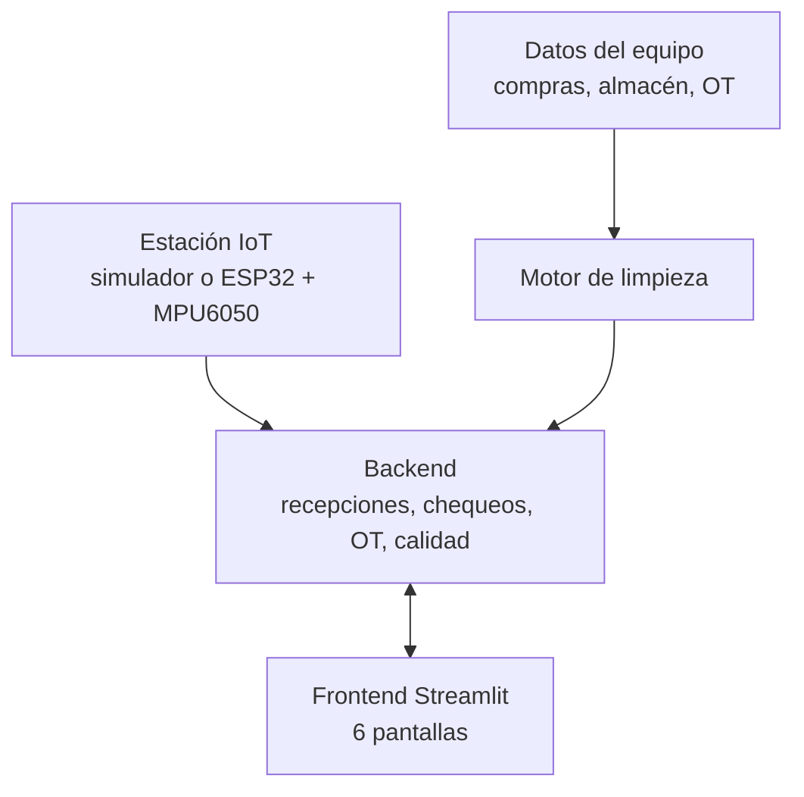

# Kardex Vivo

**Validación de compras, almacén y órdenes de trabajo con evidencia física de sensores IoT.**

Proyecto para el HackaITVER 2026, Área Mecatrónica e Industrial.

## Demo en vivo

**https://portal-directive-biblical-fin.trycloudflare.com**

Enlace temporal, activo solo durante la presentación del 25/11/2026 (túnel de Cloudflare hacia la
 laptop del equipo).
 
---

## El problema

La información de compras, almacén, costos y órdenes de trabajo presenta duplicados, inconsistencias y registros
incompletos. Validarla a mano consume tiempo y produce errores en los reportes.

## La solución

Kardex Vivo combina dos fuentes de verdad:

1. **Los datos**: un motor de limpieza revisa compras, almacén y órdenes de trabajo. Corrige solo lo que es seguro
   corregir (formato) y convierte cada problema restante en una **orden de trabajo** con su evidencia.
2. **El mundo físico**: una estación de recepción con ESP32, acelerómetro MPU6050 y báscula valida cada bulto que llega.
   El sistema no confía en lo que alguien captura: confía en lo que el sensor mide.

Cada recepción pasa cuatro chequeos (QR válido, presencia, peso y manipulación). Si algo no cuadra, se abre una orden
de trabajo para que una persona la revise, confirme o descarte.

### La historia de la demo

1. El motor detecta que la compra **C021** nunca tuvo entrada en almacén y abre una orden de trabajo.
2. El operador escanea el bulto **B-0001** (esa compra) en la estación.
3. Los sensores confirman presencia, peso correcto y que no hubo golpes.
4. La entrada se registra sola, **la orden de trabajo de C021 se cierra sola** y el índice de calidad sube en vivo.

## Resultados

| Indicador | Valor |
|---|---|
| Errores sembrados en los datos del equipo detectados por el motor | **23 de 23**, sin señalar registros fuera de la lista |
| Registros analizados | 55 (compras, almacén y OT históricas) |
| Correcciones automáticas / órdenes de trabajo generadas | 2 / 22 |
| Dinero involucrado en diferencias detectadas | $2,335 MXN |
| Escenarios físicos validados con el simulador | 7 (normal, sin presencia, peso bajo, peso alto, golpe, inclinado, ruidoso) |

## Arquitectura



| Carpeta | Qué contiene |
|---|---|
| `datos/` | Datos del equipo (`fuentes/`), sus scripts originales (`equipo/`) y el motor de limpieza integrado |
| `Hackaton/iot_hackaitver/iot/` | Detector de eventos (mismo código que irá en el ESP32), simulador de la estación y pruebas |
| `backend_mock/` | Backend de integración: implementa el contrato completo |
| `frontend/` | Aplicación web en Streamlit |
| `Hackaton/CONTRATO.md` | Contrato de datos entre todas las partes |

## Cómo ejecutarlo

Requisitos: Python 3.10 o superior.

```bash
# 1. Instalar dependencias (una sola vez)
python -m pip install -r frontend/requirements.txt

# 2. Terminal 1: backend (dejarla abierta)
python backend_mock/servidor_mock.py

# 3. Terminal 2: frontend
cd frontend
python -m streamlit run app.py
```

Se abre `http://localhost:8501`. Para usarlo desde el celular, conectar todos los equipos a la misma red,
poner la "Network URL" de Streamlit en `frontend/config.py` (`FRONT_URL`) y generar los QR con
`python frontend/generar_qr.py`.

Pruebas del detector IoT:

```bash
cd Hackaton/iot_hackaitver/iot
python -m unittest -v
```

Motor de limpieza por separado:

```bash
python datos/motor_limpieza.py
```

## Pantallas

| Pantalla | Para qué sirve |
|---|---|
| **Resumen** | Indicadores principales y acceso a cada módulo |
| **Recepción** | Pantalla del operador: escanea el QR, la estación valida y muestra el resultado con su evidencia |
| **Estación IoT** | Eventos del sensor en vivo, simulador con sus escenarios y umbrales del detector |
| **Datos** | Hallazgos del motor de limpieza, evaluación contra la hoja de respuestas y reporte para Excel |
| **Órdenes de trabajo** | Bandeja de revisión humana, descarga de cada OT en PDF y exportación a Excel |
| **Calidad de datos** | Tablero con rangos de 1 h, 24 h, 7 d y 30 d |

## Transparencia

- **Peso simulado:** la estación usa el acelerómetro MPU6050; el peso se simula hasta integrar una celda de carga
  con HX711. Cada evento indica si su origen es `simulado` o `fisico`, y la interfaz siempre lo muestra.
- **Historial de 30 días simulado:** las gráficas de 7 y 30 días usan actividad simulada (marcada en pantalla);
  la actividad real de la sesión se suma encima.
- **Errores sembrados:** el 23 de 23 se mide contra errores que el equipo colocó a propósito. Con datos reales de una
  empresa el porcentaje variará; lo que se demuestra es que cada tipo de error del enunciado se detecta.
- **Backend de integración:** guarda todo en memoria. La siguiente fase es el backend con base de datos persistente.
- **Uso de IA:** el desarrollo contó con apoyo de herramientas de inteligencia artificial. El detalle está en la
  Bitácora de IA del equipo.

## Siguientes pasos

1. Celda de carga con HX711 para medir peso real.
2. Firmware del ESP32 enviando eventos con origen `fisico`.
3. Backend con base de datos persistente (SQLite o PostgreSQL).
4. Conexión directa con el ERP de la empresa en lugar de archivos CSV.
5. Varias estaciones de recepción por almacén.

## Equipo

| Integrante | Rol |
|---|---|
| Luis | Frontend e integración |
| _Hannia_ | Backend y API |
| _Ian_ | Datos y reglas de limpieza |
| _Julio_ | IoT: detector, simulador y hardware |
| _Cintia_ | Costos, pitch y documentación |
